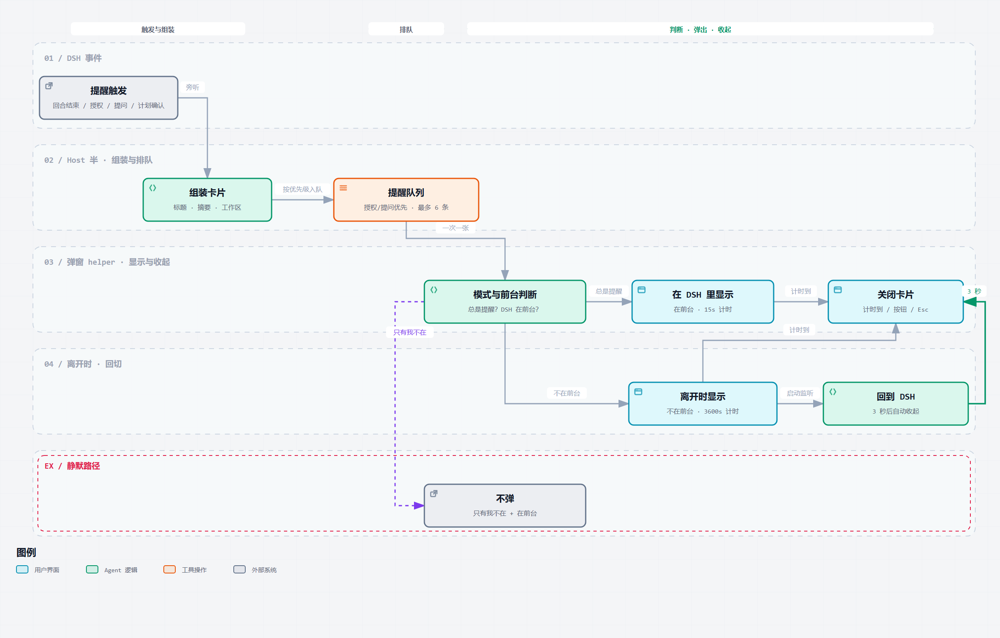

# 消息提醒 · dsh-plugin-message-notify

当一个回合在**你不在 DSH 窗口前**结束时，在屏幕右下角弹出一张小卡片，告诉你「哪个工作区、哪个对话、回复说了什么」，不用切回应用也能判断值不值得回来看。

## 流程



## 触发条件

- 一个回合正常结束，并且回复里有正文（`completed` / `max-tokens` / `interrupted`）。
- 回合被**授权请求**（工具要你批准）或**提问 / 计划确认**（`ask_user_question`、`exit_plan_mode`）挡住时也会提醒——这两类不会进入普通事件流，插件直接旁听请求，播报后原样放行，不影响原有的确认流程。
- 弹窗进程会先看前台窗口：前台进程是 DSH（`DeepSeek Harness`）时**不弹**，所以你盯着 DSH 看时不会有东西跳出来。设置页里可以改成「总是提醒」。
- 子代理（subagent）会话不提醒，避免一次主回合触发一串弹窗。

## 卡片

- 位置：主显示器工作区右下角，距屏幕右边缘 24px、距任务栏 7px（约为原来的 30%），置顶（`Topmost`），不出现在任务栏。
- 内容：小标题（`DSH 新回复` / `DSH 等待授权` / `DSH 需要你的回答` / `DSH 计划待确认`）→ 对话主题或工具/问题标题 → 摘要（授权请求显示本地化的授权原因，提问显示问题正文，约 260 字）→ 工作区（目录名 · 完整路径）。
- 提示样式可选：顶部中央的横条（默认）或小标题旁的圆点，都用「提示颜色」**呼吸**（明暗脉动，一个来回约 1.8 秒）；余光扫到就知道有新东西。
- 尺寸：宽度保持 384px；高度在内容自适应高度上再增加 30%，多出来的空间全部留给摘要正文，能多显示约 2–3 行。
- 边缘：卡片外围带一圈柔和投影（深色主题略重，浅色更淡）；窗口四周留出透明边距，阴影不会被裁掉，也不影响卡片的位置和尺寸。
- 工作区路径与按钮之间有一条 1px 细分割线，左右各留出约 5% 的空间；按钮在分割线与卡片底边之间上下居中（上下各 10px），分割线到卡片底边的距离和卡片高度都不变。
- 按钮：
  - **查看**：把 DSH 主窗口置前后关闭卡片。最小化的窗口恢复原状，最大化的保持最大化——**不改动窗口大小**；只有 DSH 根本没在运行时，才会按程序路径启动一个默认窗口。
  - **关闭**：立即关闭卡片。
- **15 秒无操作自动关闭**（设置页可改成 15–7200 秒，最长 2 小时）；鼠标停在卡片上会暂停计时，移开重新计时，方便慢慢读。
- 你自己切回 DSH（Alt-Tab、点任务栏、点窗口都算）后 **3 秒**，卡片自动关闭，不会继续挂在你刚要看的窗口上面；两种提醒模式都这样，「测试提醒」卡片除外（它只按计时关闭）。卡片出现时 DSH 本来就在前台的话，按设置里「在 DSH 里」的秒数计时，不会被这条规则提前收起。
- 同一时刻只显示一张卡片，不会堆叠成一片。**新的回复会直接替换当前正在显示的回复卡**（小标题、标题、摘要和倒计时都换成最新一条，计时重新开始）；授权/提问到达时会先收掉回复卡、优先显示。队列只在回复被优先级卡片挡住时短暂使用（最多 6 条），满了先丢普通回复，不会丢等你确认的卡片。

## 黑白主题

- 弹窗配色取自 DSH 自己的 token：深色 `#232324` 卡面 / `#F9FAFB` 主文字 / `#ADB2B8` 次要文字，浅色 `#FFFFFF` / `#0F1115` / `#61666B`；主按钮是 DSH 式的「反色实心」（深色模式下白底黑字）。
- 插件带一个 Client 半，读取当前主题（`theme` 服务的 `active.colorScheme`，读不到时看 `body[data-ds-dark-theme]`），通过私有路由告诉 Host，所以即使 DSH 主题与 Windows 主题不一致，卡片也跟 DSH 走。
- 页面从未上报过主题时（例如 DSH 刚启动、还没加载 UI），回退到 Windows 的「应用深色模式」设置。

## 安装

DSH 桌面端 → 设置 → 插件 → 从本地目录安装本目录，然后重启 DSH。安装后出现在插件列表里，带图标和「消息提醒 / Reply Popup」的标题描述。

## 设置页

设置 → 插件 → `dsh-plugin-message-notify` → 点开「包含的组件」里的那一行，就能进入设置页。每一项都是左边标题、右边控件；标题旁的 `i` 悬停（或键盘聚焦）会弹出说明，样式跟随 DSH 的黑白主题。下拉框和调色板是自建的浮层（背景、描边、阴影都取 DSH 的 token），单选框放在文字右边。改动都先留在本地草稿里：没改动时「保存」是灰的不可点，有改动才变成实心可点；保存成功后又回到不可点状态。

| 设置 | 说明 |
| --- | --- |
| 提醒时机 | 「只有我不在 DSH 时」（默认）或「总是提醒」。 |
| 自动收起 | 「只有我不在 DSH 时」只有一条：15–7200 秒，默认 15 秒；「总是提醒」可以分开设两条——你在 DSH 里时（默认 15 秒）和你离开 DSH 时（默认 15 秒）。鼠标悬停会暂停计时。 |
| 提示样式 | 顶部横条（默认）或标题旁圆点；两种都用「提示颜色」呼吸。切换后下一张卡片生效。 |
| 主题 | 「跟随 DSH 主题」（默认）、深色、浅色。 |
| 提示颜色 | 横条或圆点的呼吸强调色；默认跟随主题（深色 #5686FE / 浅色 #4176E6）。点开色块可以：在色盘上拖选任意颜色、拖色相条、直接输入 `#RRGGBB`，或从 10 个预设里挑一个。 |
| 提示音 | 卡片出现时播放 Windows 的「通知」系统音（`%SystemRoot%\Media\Windows Notify System Generic.wav`；没有该文件时回退到系统 Asterisk 音）；关掉后静音。同一张卡片的替换不会重复响。 |
| 测试正文 | 点「测试提醒」时卡片正文显示的文本，最多 260 字；留空则显示默认提示。不保存也会用当前输入测试。 |
| 测试提醒 | 立刻弹一张测试卡片，用来确认整条链路是通的；卡片正文使用「测试正文」里填写的文字。 |

想彻底关掉提醒时，用插件详情页右上角的开关（或插件列表里那一行的开关）——那个开关是真的停掉插件，设置页就不再放一个重复的总开关了。

设置存在 `%DSH_HOME%\plugin-data\dsh-message-notify\settings.json`（默认 `C:\Users\<你>\.dsh\...`），保存后对下一张卡片立即生效，不需要重启。设置页里的值优先于下面的 patch `config`。

## 可选配置

走 bundle patch 的 `config` 时，只有下面这些键；`timeoutSeconds` / `themeMode` 只是**初始值**，设置页保存过之后以设置页为准：

| 键 | 默认 | 说明 |
| --- | --- | --- |
| `timeoutSeconds` | `15` | 初始的「你离开 DSH 时」自动关闭秒数。 |
| `focusedTimeoutSeconds` | `15` | 初始的「你在 DSH 里时」自动关闭秒数（只在「总是提醒」下生效）。 |
| `focusProcess` | `DeepSeek Harness` | 视为「你正在 DSH 里」的进程名；「查看」也用它来置前。 |
| `themeMode` | `auto` | 初始的配色模式：`auto`（跟 DSH / Windows）/ `dark` / `light`。 |
| `indicator` | `bar` | 初始的提示样式：`bar`（顶部横条）/ `dot`（标题旁圆点）。 |
| `dotColor` | 空 | 初始的提示颜色（横条 / 圆点），`#RRGGBB`；空表示跟随主题。 |
| `testText` | 空 | 测试卡片的初始正文；设置页保存过之后以设置页为准。 |
| `sound` | `true` | 初始的提示音开关；设置页保存过之后以设置页为准。 |
| `tracePath` | 空 | 给 helper 的调试落点，写 `HH:mm:ss.fff` 时间戳行；生产环境留空。 |

## 排查

- 卡片完全不出：设环境变量 `DSH_MESSAGE_NOTIFY_DEBUG=1` 后重启 DSH，Host 半会在 stderr 打出「收到回合结束 / 建临时目录 / spawn helper pid / helper 退出码」。正常一次显示的痕迹是 `showing "…"` + `spawned helper pid=…` + `helper exit code=0`。
- 卡片出现但不消失：helper 有看门狗（自动收起时长 + 60 秒，至少 120 秒），超时会放弃这次并继续下一张；同时检查 `popup.ps1` 是否能被本机 Windows PowerShell 5.1 执行（`powershell.exe -NoProfile -STA -ExecutionPolicy Bypass -File popup.ps1 -PayloadPath <payload>`）。
- 主题不对：确认 Client 半已加载（重启后打开一次 DSH 窗口即可上报）；`tracePath` 里会有 `theme=dark|light`。也可以直接访问 `GET /plugins-local/dsh-message-notify-theme`，返回 `reportedDark` / `ageSeconds` 表示页面最近一次上报的内容和时间。

## 已知限制

- 只支持 Windows：卡片是 PowerShell + WPF 的置顶窗口，依赖系统自带的 Windows PowerShell 5.1。
- 弹窗固定出现在主显示器右下角；DSH 在副屏时也一样。
- 「查看」只把 DSH 带到前台，不会跳到产生这条提醒的会话。
- 授权与提问的卡片只做提示，不显示可选项，也不能在卡片上直接批准——批准仍要回到 DSH。
- 「DSH 没在运行才启动」这条只有在进程确实不存在时才会触发；如果它只是隐藏到托盘、没有主窗口，插件不会重复启动一个实例。
- 卡片文字会以 JSON 写入系统临时目录再交给 helper，退出后立刻删除；内容不离开本机。
- 提示音只在卡片真正弹出时播放一次：被「只有我不在」跳过时不响，同一张卡片被新消息替换时也不重复响。

## 开发

改了 `index.js`（Host 半）或 `client.js` 后都要重启 DSH 才生效。离线验证：

```powershell
$env:SCENARIO = 'approval'   # reply | approval | question | plan
$env:POPUP_TIMEOUT = '5'
node .test/drive.mjs

# 设置页路由：默认值、校验、落盘、测试提醒
node .test/settings.mjs
```
